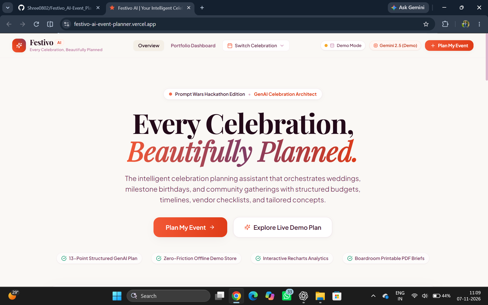
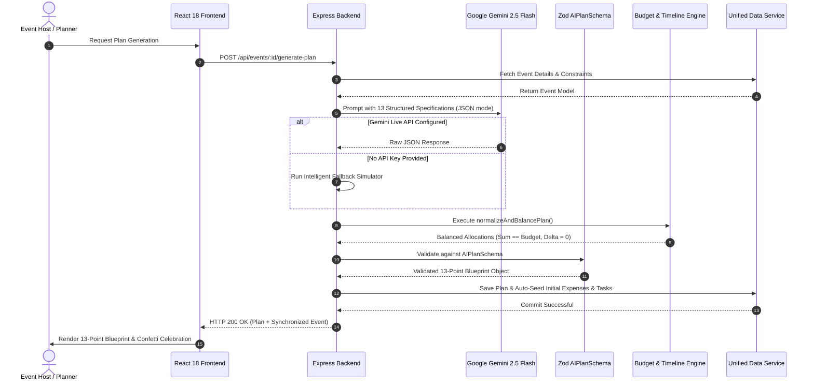
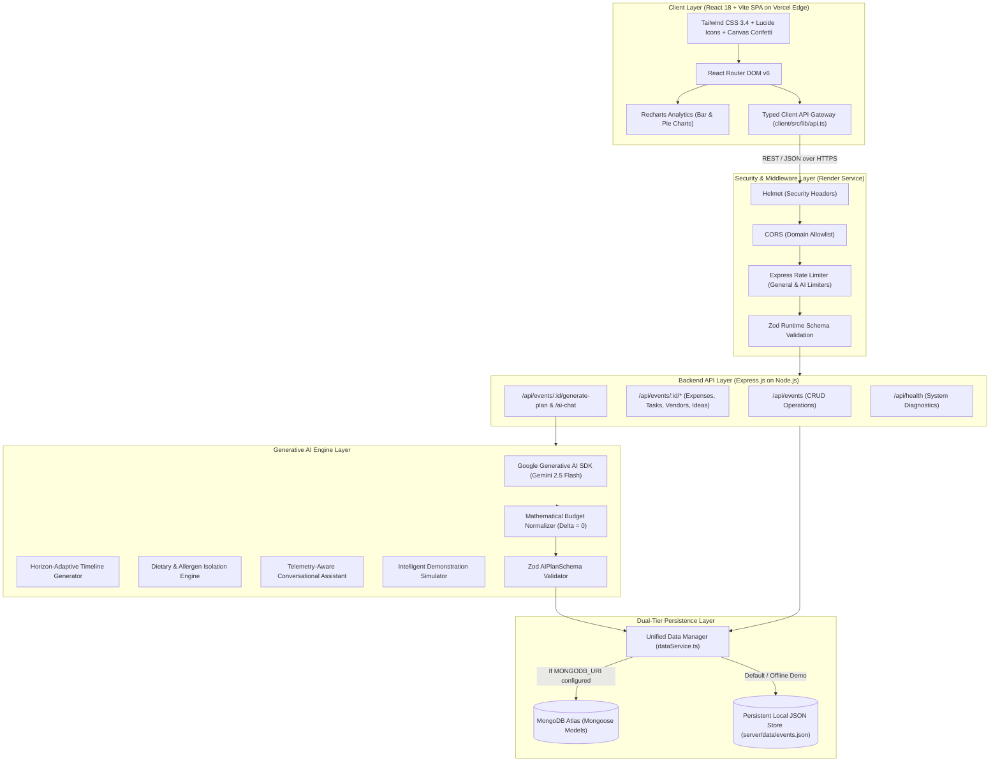
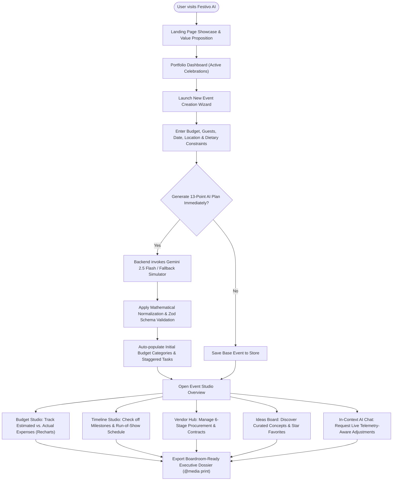

<div align="center">

# 🎊 Festivo_AI
### *Every Celebration, Beautifully Planned.*

**An Intelligent AI-Powered Event Planning and Management SaaS Platform**  
*Engineered for the Prompt Wars Generative AI Competition*

<br/>

<a href="https://festivo-ai-event-planner.vercel.app/" target="_blank">
  
</a>
&nbsp;&nbsp;
<a href="https://github.com/Shree0802/Festivo_AI-Event_Planner" target="_blank">
  
</a>
&nbsp;&nbsp;
<a href="docs/demo-script.md">
  
</a>

<br/><br/>

[](https://github.com/Shree0802/Festivo_AI-Event_Planner/actions)
[](server/src/__tests__/)
[](https://www.typescriptlang.org/)
[](https://react.dev/)
[](https://tailwindcss.com/)
[](https://ai.google.dev/)
[](https://opensource.org/licenses/MIT)
[]()

<br/>

[🌟 **Launch Live Demo**](https://festivo-ai-event-planner.vercel.app/) • [🎯 Problem & Solution](#-problem-statement--solution) • [✨ Key Features](#-key-features--capabilities) • [🧠 AI Architecture](#-ai-engine--intelligence-architecture) • [🏗️ System Architecture](#-system-architecture) • [⚡ Quick Start](#-installation--local-development) • [🧪 Test Suite](#-testing--quality-assurance) • [📖 API Reference](#-api-documentation) • [🚀 Deployment](#-deployment-guide)

</div>

---

<div align="center">

<a href="https://festivo-ai-event-planner.vercel.app/" target="_blank">
  
</a>

</div>

---

## 📑 Table of Contents

- [🎯 Problem Statement & Solution](#-problem-statement--solution)
  - [The Challenge of Event Planning](#the-challenge-of-event-planning)
  - [The Festivo AI Solution](#the-festivo-ai-solution)
  - [🌐 Public Live Deployment](#-public-live-deployment)
  - [Feature Comparison Matrix](#feature-comparison-matrix)
- [✨ Key Features & Capabilities](#-key-features--capabilities)
- [🧠 AI Engine & Intelligence Architecture](#-ai-engine--intelligence-architecture)
  - [The 13-Point Validated Celebration Blueprint](#the-13-point-validated-celebration-blueprint)
  - [Mathematical Budget Normalizer ($\Delta = \text{₹0}$)](#mathematical-budget-normalizer-delta--text0)
  - [Horizon-Adaptive Timeline Generator](#horizon-adaptive-timeline-generator)
  - [Dietary & Allergen Isolation Engine](#dietary--allergen-isolation-engine)
  - [Context-Aware Conversational Assistant](#context-aware-conversational-assistant)
  - [Intelligent Simulation Fallback Mode](#intelligent-simulation-fallback-mode)
- [💻 Technology Stack Showcase](#-technology-stack-showcase)
- [🏗️ System Architecture](#-system-architecture)
- [🔄 Application Workflow & User Journey](#-application-workflow--user-journey)
- [📸 Visual Showcase & Screenshots](#-visual-showcase--screenshots)
- [📂 Project Directory Map](#-project-directory-map)
- [⚡ Installation & Local Development](#-installation--local-development)
  - [Prerequisites](#prerequisites)
  - [Environment Configuration](#environment-configuration)
  - [Development Mode (Dual Server)](#development-mode-dual-server)
  - [Production Single-Port Mode](#production-single-port-mode)
- [📖 API Documentation](#-api-documentation)
  - [Events Endpoints](#events-endpoints)
  - [AI & Intelligence Endpoints](#ai--intelligence-endpoints)
  - [Sub-Resource Endpoints (Expenses, Tasks, Vendors, Ideas)](#sub-resource-endpoints)
- [🧪 Testing & Quality Assurance](#-testing--quality-assurance)
  - [Test Suite Breakdown (41 / 41 Passing)](#test-suite-breakdown-41--41-passing)
  - [Executing Automated Tests](#executing-automated-tests)
- [🚀 Deployment Guide](#-deployment-guide)
  - [Official Deployment Endpoints](#official-deployment-endpoints)
  - [1. Primary Frontend Deployment on Vercel](#1-primary-frontend-deployment-on-vercel)
  - [2. Backend REST API & AI Service on Render](#2-backend-rest-api--ai-service-on-render)
  - [3. Unified Production Alternative (Single-Port Monolith)](#3-unified-production-alternative-single-port-monolith)
- [🏆 Competition & Hackathon Deliverables](#-competition--hackathon-deliverables)
- [🔮 Future Roadmap](#-future-roadmap)
- [🤝 Contributing](#-contributing)
- [📄 License & Authors](#-license--authors)

---

## 🎯 Problem Statement & Solution

### The Challenge of Event Planning
Organizing life celebrations—such as multi-day weddings, milestone birthdays, anniversaries, inter-college cultural festivals, and community celebrations—is inherently stressful and fragmented:

- **Mathematical Budget Disasters**: Planners rely on spreadsheets prone to formula errors, hidden expenses, and zero-sum violations where totals fail to match available funds.
- **Generic AI Hallucinations**: Standard chatbots produce generic walls of text, recommend impossible timelines (e.g., suggesting vendor bookings "8 weeks prior" for an event happening in 4 days), or suggest recipes that cross-contaminate allergens and cultural dietary boundaries.
- **Disconnected Execution**: Chatbot suggestions exist in a vacuum. Users must manually copy-paste recommendations into separate todo lists, vendor spreadsheets, and finance trackers.
- **Loss of Financial Telemetry**: When asked for cost-cutting advice, standard conversational assistants have no idea how much money has already been spent, what buffer remains, or which vendor contracts are non-negotiable.

### The Festivo AI Solution
**Festivo AI** bridges the gap between state-of-the-art Generative AI and structured event execution. Built specifically for the **Prompt Wars Generative AI Competition**, Festivo AI pairs **Google Gemini 2.5 Flash** with a robust, type-safe full-stack management suite:

```
┌────────────────────────────────────────────────────────────────────────┐
│                              FESTIVO AI                                │
│                                                                        │
│   ┌────────────────────────┐            ┌──────────────────────────┐   │
│   │   Generative AI Layer  │            │  Management SaaS Layer   │   │
│   │   • Google Gemini 2.5  │  ───────►  │  • 100% Rupee Balancer   │   │
│   │   • 13-Point Blueprint │  Strict    │  • Dynamic Timeline Gaps │   │
│   │   • Contextual Chat    │  Zod JSON  │  • 6-Stage Vendor Kanban │   │
│   │   • Allergen Isolation │  Contract  │  • Recharts Visuals      │   │
│   └────────────────────────┘            └──────────────────────────┘   │
└────────────────────────────────────────────────────────────────────────┘
```

### 🌐 Public Live Deployment
Festivo AI is live and publicly accessible at **[https://festivo-ai-event-planner.vercel.app/](https://festivo-ai-event-planner.vercel.app/)**. Visitors and hackathon evaluators can immediately:
- **Explore Active Celebrations**: Browse through real-world event portfolios with live budget utilization meters and countdown timers.
- **Experience the 13-Point AI Blueprint**: Generate full event plans with harmonic color palettes, venue matching, and dietary isolation.
- **Interact with the Contextual AI Assistant**: Ask questions like *"How can I reduce expenses by 10%?"* and receive real-time telemetry-aware financial answers with executable action buttons.
- **Track Expenses & Milestones**: Interact with responsive Recharts visual analytics and trigger milestone confetti celebrations.

### Feature Comparison Matrix

| Capability Dimension | Traditional Spreadsheets | Generic AI Chatbots | 🎊 Festivo AI Platform |
| :--- | :---: | :---: | :---: |
| **Mathematical Budget Integrity** | ⚠️ Broken formulas, manual sync | ❌ Hallucinates sums, misses totals | ✅ **100.0% Exact Rupee Allocation ($\Delta = \text{₹0}$) across 9 categories** |
| **Structured Output Architecture** | ❌ Fragmented across tabs | ⚠️ Disorganized prose / walls of text | ✅ **13-Point Zod-guarded JSON blueprint with typed sub-resources** |
| **Context Retention in Chat** | ❌ No AI integration | ❌ Forgets active spend and buffer | ✅ **Real-time telemetry injection (spent funds, buffer, pending tasks)** |
| **Timeline Horizon Adaptation** | ❌ Static dates, no heuristics | ❌ Recommends "8 weeks prior" for 2-day fests | ✅ **Horizon-Adaptive Engine (Sprint Phase 1-3 vs. 8-12 Weeks Sequencing)** |
| **Dietary & Allergen Rigor** | ⚠️ Human oversight errors | ⚠️ Contaminates vegan/Jain dishes | ✅ **Strict culinary isolation (certified vegan, nut-free, Satvik)** |
| **Vendor Procurement Pipeline** | ⚠️ Untracked notes and scraps | ❌ Cannot manage vendor status | ✅ **6-Stage procurement lifecycle with 1-click call/email links** |
| **Visual Analytics** | ⚠️ Manual bar/pie generation | ❌ No visual charting capability | ✅ **Interactive Recharts (Estimated vs. Actual Bar & Pie Shares)** |
| **Executive PDF Export** | ⚠️ Ugly spreadsheet prints | ❌ Inconvenient copy-pasting | ✅ **Boardroom-ready `@media print` CSS dossier generated in 1 click** |
| **Zero-Friction Evaluator Demo** | ❌ Requires database setup | ❌ Requires paid API key upfront | ✅ **Dual-Tier: MongoDB Atlas + offline local JSON fallback store** |

---

## ✨ Key Features & Capabilities

<table>
<tr>
<td width="50%" valign="top">

### 1. 🤖 13-Point AI Blueprint Studio
Generates a comprehensive celebration blueprint covering color hex palettes, zonal decor, curated catering menus, minute-by-minute run-of-show schedules, and contingency protocols. Every section is validated through runtime Zod schemas.

</td>
<td width="50%" valign="top">

### 2. 💰 Precision Budget Engine
Breaks down budgets across 9 standardized categories (venue, catering, decor, photography, entertainment, invitations, transport, styling, contingency). Interactive Recharts charts compare estimated vs. actual expenses with live variance tracking.

</td>
</tr>
<tr>
<td width="50%" valign="top">

### 3. ⏱️ Horizon-Adaptive Timeline
Automatically structures preparation milestones based on remaining days before the celebration. Adapts from rapid 3-phase sprints (for events within 14 days) to 8-12 week staggered sequencing for long-lead galas.

</td>
<td width="50%" valign="top">

### 4. 🤝 6-Stage Vendor Procurement Hub
Tracks vendor relationships from research to completion (`to_research`, `shortlisted`, `contacted`, `negotiating`, `booked`, `cancelled`). Includes contact management, contract amounts, and one-click phone and email action links.

</td>
</tr>
<tr>
<td width="50%" valign="top">

### 5. 💬 Telemetry-Aware AI Chat Assistant
An in-context event planner that retains live celebration metrics: total budget, committed spend, remaining buffer, headcount, and pending tasks. Recommends targeted adjustments with 1-click executable action buttons.

</td>
<td width="50%" valign="top">

### 6. 💡 Inspiration & Ideas Gallery
Curated celebration inspiration categorized by Food & Beverage, Guest Experience, and Entertainment. Features star favoriting, estimated price brackets, implementation notes, and on-demand AI idea generation.

</td>
</tr>
<tr>
<td width="50%" valign="top">

### 7. 📄 Boardroom-Ready Executive Dossier
Custom `@media print` CSS engine transforms complex digital event state into a formatted, high-contrast executive summary report suitable for sharing with family, clients, or venue managers.

</td>
<td width="50%" valign="top">

### 8. ⚡ Dual-Tier Persistence Architecture
Zero configuration required for competition evaluators. Festivo AI automatically detects MongoDB Atlas when configured, or seamlessly falls back to a persistent local JSON store (`server/data/events.json`).

</td>
</tr>
</table>

---

## 🧠 AI Engine & Intelligence Architecture

### Generative AI Integration
Festivo AI utilizes **Google Gemini 2.5 Flash** (`gemini-2.5-flash`) via the official `@google/generative-ai` SDK. All AI interactions occur exclusively on the backend to safeguard API credentials, sanitize inputs, enforce rate limits, and validate output structures before delivering responses to the client.



### The 13-Point Validated Celebration Blueprint
Each generated celebration plan strictly adheres to the runtime [`AIPlanSchema`](server/src/schemas/index.ts):

```text
Section A  │ Executive Celebration Summary
Section B  │ Visual Design Themes (Theme name, sensory vibe, harmonized hex palettes)
Section C  │ Zonal Decor Concepts & Clamped Cost Estimates (Entrance, Main Stage, Dining)
Section D  │ Venue Recommendations (Capacity matches, price brackets, pros & considerations)
Section E  │ Gourmet Catering Architecture (Drinks, Appetizers, Mains, Desserts, Dietary Isolation)
Section F  │ Entertainment & Sensory Flow (Welcome, Speeches, Open Dance Floor)
Section G  │ Mathematical Budget Allocations (9 Categories, adds up to exactly 100%)
Section H  │ Horizon-Adaptive Preparation Timeline (Sprint Phase 1-3 vs. 8-12 Weeks Sequencing)
Section I  │ Vendor Procurement Checklist & Critical Interview Questions
Section J  │ Minute-by-Minute Run-of-Show Day-of Schedule
Section K  │ Risk Mitigation & Contingency Protocols (Weather, audio redundancy, headcount surges)
Section L  │ Personalized Local & Cultural Recommendations
Section M  │ Cost-Saving Opportunities with Trade-Off Transparency
```

### Mathematical Budget Normalizer ($\Delta = \text{₹0}$)
A critical flaw in standard LLMs is their inability to perform reliable integer arithmetic across multiple categories. Festivo AI implements a deterministic normalization algorithm (`normalizeAndBalancePlan` in [`server/src/services/aiService.ts`](server/src/services/aiService.ts)):

$$\sum_{i=1}^{9} \text{AllocatedAmount}_i = \text{TotalBudget} \quad \text{and} \quad \sum_{i=1}^{9} \text{Percentage}_i = 100.0\%$$

1. **Percentage Clamping**: Ensures every category allocation is non-negative and scales percentages proportionally so they sum to exactly 100.0%.
2. **Integer Rupee Precision**: Rounds allocated amounts to whole integers.
3. **Zero-Rupee Remainder Balancing**: Calculates the delta between the total allocated sum and the total budget:
   $$\Delta = \text{TotalBudget} - \sum \text{AllocatedAmount}$$
   Any remaining discrepancy (due to rounding) is assigned to the `miscellaneous` or largest expense category, ensuring zero financial drift.

### Horizon-Adaptive Timeline Generator
Rather than relying on static checklists, Festivo AI evaluates the difference between the celebration date and the creation date:
- **Rapid Sprint Horizon ($\le 14$ days remaining)**: Splits preparation into 3 accelerated phases (*Phase 1: Immediate Lockdown [Days 1–2]*, *Phase 2: Final Procurement [Days 3–5]*, *Phase 3: Day-Before Rehearsal*).
- **Staggered Milestone Horizon ($> 14$ days remaining)**: Distributes tasks across logical milestones (*8–12 Weeks Out: Venue & Themes*, *4–6 Weeks Out: Vendors & Invitations*, *2 Weeks Out: Final Headcounts*, *Final Week: Logistics*).

### Dietary & Allergen Isolation Engine
To prevent catastrophic culinary oversights, Festivo AI enforces strict ingredient separation rules:
- **Vegan Protocol**: Zero dairy, butter, ghee, or paneer; relies on rich coconut-milk gravies, smoked tofu, and cold-pressed oils.
- **Nut-Free Protocol**: Strict exclusion of peanuts, cashews, almonds, and tree-nut pastes; seeds (sunflower, sesame) substituted for texture.
- **Satvik / Jain Protocol**: Complete exclusion of root vegetables (onions, garlic, potatoes); flavored with asafoetida (hing), fresh ginger, cumin, and rock salt.

### Context-Aware Conversational Assistant
The interactive celebration assistant (`POST /api/events/:id/ai-chat`) injects real-time event telemetry into each prompt context:
- Current event name, type, date, location, and guest count.
- Total budget, actual spend recorded to date, remaining financial buffer, and budget utilization percentage.
- Total count of pending tasks and overdue deadlines.
- Dietary requirements and cultural traditions.
- Returns actionable conversational suggestions with structured execution metadata (e.g., `adjust_budget`, `add_task`).

### Intelligent Simulation Fallback Mode
If no `GEMINI_API_KEY` is provided in the environment, Festivo AI automatically activates an **Intelligent Simulation Engine**. This engine procedurally constructs a 13-point plan tailored to the event's exact type, budget, guest count, location, and dietary constraints—enabling judges and reviewers to test the entire application workflow out of the box with zero external configuration.

---

## 💻 Technology Stack Showcase

| Category | Technology | Version | Purpose & Implementation Details |
| :--- | :--- | :---: | :--- |
| **Frontend Framework** | **React** | `18.3.1` | Component-driven UI architecture, custom hooks, and state management |
| **Language** | **TypeScript** | `5.6.3` | End-to-end type safety across client interfaces, backend schemas, and API contracts |
| **Build Tool** | **Vite** | `5.4.10` | Fast HMR, Rollup production bundling, and optimized asset splitting |
| **Styling & Design** | **Tailwind CSS** | `3.4.14` | Utility-first responsive design, custom celebration color theme, and print styles |
| **Icons & UI** | **Lucide React** | `0.460.0` | Accessible, consistent iconography across all tabs and status indicators |
| **Data Visualization** | **Recharts** | `2.13.3` | Responsive SVG bar charts (estimated vs. actual) and category distribution pie charts |
| **Micro-Interactions** | **Canvas Confetti** | `1.9.4` | Milestone celebration effects on task completion and plan generation |
| **Routing** | **React Router DOM** | `6.28.0` | Client-side routing, URL parameter synchronization, and navigation guard |
| **Backend Runtime** | **Node.js** | `v20+` / `v24` | High-throughput asynchronous runtime hosting the REST API server |
| **Web Framework** | **Express.js** | `4.21.1` | RESTful routing, parameter extraction, and static file serving |
| **Generative AI** | **Google Gemini** | `gemini-2.5-flash` | Server-side LLM via `@google/generative-ai` for structured plan & chat generation |
| **Schema Validation** | **Zod** | `3.23.8` | Runtime validation for API requests, AI responses, and configuration schemas |
| **Database (Primary)** | **MongoDB Atlas** | `8.7.3` (Mongoose) | Cloud document store for production event persistence |
| **Database (Fallback)** | **Local JSON Store** | Native Node.js FS | File-backed atomic JSON persistence for zero-config demo mode |
| **Security & Headers** | **Helmet** | `8.0.0` | Secure HTTP response headers and vulnerability protection |
| **Security & Rate Limit** | **Express Rate Limit** | `7.4.1` | Ingress protection: 300 req/15min general limiter, 30 req/5min AI limiter |
| **CORS Management** | **CORS** | `2.8.5` | Dynamic domain allowlist supporting cloud deployments and local dev |
| **Testing Framework** | **Vitest** | `2.1.9` | Ultra-fast unit & integration test runner with TypeScript execution |

---

## 🏗️ System Architecture

Festivo AI is architected as a decoupled full-stack application separating fast edge client delivery from a resilient REST API computing service:



---

## 🔄 Application Workflow & User Journey



---

## 📸 Visual Showcase & Screenshots

Festivo AI features a responsive UI inspired by warm celebration palettes (champagne gold, royal plum, and festive coral).

<div align="center">

| View / Feature | Preview Mockup & Asset Reference | Description |
| :--- | :---: | :--- |
| **Landing Page** | `assets/screenshots/01-landing-hero.png` | Festive hero header, celebration category cards, value proposition, and quick CTA |
| **Event Dashboard** | `assets/screenshots/02-event-dashboard.png` | Portfolio metrics, celebration countdown timers, budget meters, and event cards |
| **New Event Wizard** | `assets/screenshots/03-new-event-modal.png` | Multi-field guided creation form with budget, guest count, theme, and dietary needs |
| **13-Point AI Planner** | `assets/screenshots/04-ai-event-planner.png` | Color hex palettes, zonal decor, curated menus, run-of-show schedule, and trade-offs |
| **Budget & Analytics** | `assets/screenshots/05-budget-manager.png` | Recharts bar charts comparing estimated vs actual, allocation pie chart, and expense logs |
| **Timeline & Tasks** | `assets/screenshots/06-timeline-manager.png` | Horizon-adaptive sprint phases, overdue deadline badges, and confetti completion triggers |
| **Vendor Procurement** | `assets/screenshots/07-vendor-pipeline.png` | 6-stage procurement pipeline, vendor contact cards, and 1-click call/email links |
| **Ideas Gallery** | `assets/screenshots/08-ideas-board.png` | Curated celebration concepts, star favoriting, price ranges, and on-demand AI ideation |
| **Contextual AI Chat** | `assets/screenshots/09-ai-chat-assistant.png` | Real-time celebration telemetry panel with contextual chat and 1-click action buttons |

</div>

> [!NOTE]
> Detailed guidelines for capturing and saving application screenshots in compressed PNG/WebP format are documented in [`assets/screenshots/README.md`](assets/screenshots/README.md).

---

## 📂 Project Directory Map

```text
Festivo_AI-Event_Planner/
├── .github/
│   ├── workflows/
│   │   └── ci.yml                 # Automated CI: build check, Vitest suite & repository size ceiling
│   ├── ISSUE_TEMPLATE/            # Structured bug report & feature request templates
│   └── PULL_REQUEST_TEMPLATE.md   # PR contribution checklist & verification standard
├── assets/
│   └── screenshots/               # Application walkthrough screenshots & visual assets
│       └── README.md              # Screenshot capture guide and image specifications
├── client/                        # Frontend Single Page Application (React 18 + Vite)
│   ├── public/                    # Static assets & application icons
│   ├── src/
│   │   ├── components/            # Reusable UI components
│   │   │   ├── EventSubNav.tsx    # Sub-navigation bar across event modules
│   │   │   ├── Footer.tsx         # Application footer with competition credits
│   │   │   └── Navbar.tsx         # Global navigation header with brand lockup
│   │   ├── lib/
│   │   │   ├── api.ts             # Typed REST API client & error handling gateway
│   │   │   └── utils.ts           # Currency formatters, date helpers, class merger
│   │   ├── pages/                 # Full-page application views
│   │   │   ├── AIPlannerPage.tsx  # 13-point AI plan viewer & interactive chat sidebar
│   │   │   ├── BudgetPage.tsx     # Recharts budget charts & expense management
│   │   │   ├── DashboardPage.tsx  # Active celebrations portfolio & high-level KPIs
│   │   │   ├── EventOverviewPage.tsx # Master event hub & printable executive PDF dossier
│   │   │   ├── IdeasPage.tsx      # Curated celebration inspiration & star favoriting
│   │   │   ├── LandingPage.tsx    # Public welcome page, feature showcase & CTAs
│   │   │   ├── NewEventPage.tsx   # Guided event creation wizard
│   │   │   ├── NotFoundPage.tsx   # 404 error handler view
│   │   │   ├── TimelinePage.tsx   # Horizon-adaptive task schedule & run-of-show
│   │   │   └── VendorsPage.tsx    # 6-stage vendor procurement pipeline
│   │   ├── App.tsx                # React Router v6 tree & route definitions
│   │   ├── index.css              # Tailwind base, components, utilities & @media print styles
│   │   ├── main.tsx               # Client entry point
│   │   ├── types.ts               # Shared domain interfaces & type definitions
│   │   └── vite-env.d.ts          # Vite environment variable declarations
│   ├── index.html                 # HTML template with Google Fonts & responsive viewport
│   ├── package.json               # Client dependencies & scripts
│   ├── tsconfig.json              # Client TypeScript compiler configuration
│   ├── vercel.json                # Vercel SPA client-side routing rewrite rules
│   └── vite.config.ts             # Vite bundler settings & API proxy configuration
├── server/                        # Backend REST API Service (Node.js + Express)
│   ├── data/
│   │   └── events.json            # Persistent local JSON store (zero-config demo mode)
│   ├── src/
│   │   ├── routes/
│   │   │   ├── aiRoutes.ts        # AI plan generation, contextual chat & idea brainstorming
│   │   │   └── eventRoutes.ts     # CRUD for events, expenses, tasks, vendors & ideas
│   │   ├── schemas/
│   │   │   └── index.ts           # Zod validation schemas (AIPlanSchema, CreateEventSchema)
│   │   ├── services/
│   │   │   ├── aiService.ts       # Gemini 2.5 Flash integration & budget normalizer
│   │   │   └── dataService.ts     # Dual-tier database manager (MongoDB Atlas + Local JSON)
│   │   ├── types/
│   │   │   └── index.ts           # Backend TypeScript types & models
│   │   ├── __tests__/
│   │   │   ├── aiEngineEvaluation.test.ts # 30 automated tests: AI scenarios & stress tests
│   │   │   └── calculations.test.ts       # 11 automated tests: math & validation integrity
│   │   └── index.ts               # Express application entry, security middleware & port binding
│   ├── package.json               # Server dependencies & scripts
│   └── tsconfig.json              # Server TypeScript compiler configuration
├── docs/
│   ├── architecture.md            # In-depth architectural specifications & data flows
│   └── demo-script.md             # 3-minute 30-second presentation walkthrough script
├── .env.example                   # Root environment configuration template
├── .gitignore                     # Git exclusion rules ensuring < 10 MB repository footprint
├── LICENSE                        # MIT Open Source License
├── package.json                   # Root monorepo workspace scripts
├── README.md                      # This documentation
└── render.yaml                    # Infrastructure-as-Code blueprint for Render deployment
```

---

## ⚡ Installation & Local Development

### Prerequisites
- **Node.js**: `v18.0.0` or higher (`v20+` or `v24` recommended).
- **npm**: `v9.0.0` or higher.
- *(Optional)* **Google Gemini API Key**: Obtain a key at [Google AI Studio](https://aistudio.google.com/). If omitted, Festivo AI automatically activates its intelligent demonstration simulator.
- *(Optional)* **MongoDB Connection URI**: MongoDB Atlas or local MongoDB instance. If omitted, Festivo AI automatically utilizes the persistent local JSON store (`server/data/events.json`).

### 1. Clone the Repository
```bash
git clone https://github.com/Shree0802/Festivo_AI-Event_Planner.git
cd Festivo_AI-Event_Planner
```

### 2. Install Dependencies
Install all root, client, and server dependencies with a single command:
```bash
npm run install:all
```

### 3. Environment Configuration
Create a `.env` file in the `server` directory (or configure root environment variables):

```bash
# Optional: server/.env
PORT=5000
NODE_ENV=development
CLIENT_URL=http://localhost:5173

# Optional: Google Gemini API Key (leave empty for intelligent demo simulator)
GEMINI_API_KEY=your_gemini_api_key_here

# Optional: MongoDB Atlas URI (leave empty for local JSON store fallback)
MONGODB_URI=
```

### Development Mode (Dual Server)
For live development with hot module replacement (HMR), run the client and server in separate terminal windows:

```bash
# Terminal 1: Backend API Service (Port 5000)
npm run dev:server

# Terminal 2: Frontend Client Service (Port 5173)
npm run dev:client
```
👉 Open your browser at **`http://localhost:5173`**! The Vite dev server proxies API calls automatically to `http://localhost:5000/api`.

---

### Production Single-Port Mode
To simulate the deployed cloud environment locally, compile both client and server into a unified build:

```bash
# 1. Build client and server bundles cleanly
npm run build

# 2. Launch the unified Express server
npm start
```
👉 Open your browser at **`http://localhost:5000`**! The Express backend serves both the REST API endpoints and the compiled React single-page application.

---

## 📖 API Documentation

Festivo AI provides a comprehensive, RESTful API. All API requests accept and return `application/json`. Endpoints are protected by rate limiting and strict Zod runtime schema validation.

### System Diagnostics
| Method | Endpoint | Description | Rate Limit |
| :---: | :--- | :--- | :---: |
| `GET` | `/api/health` | Returns server uptime, storage status (MongoDB vs. Local JSON), and AI provider status | General |

---

### Events Endpoints
| Method | Endpoint | Request Body | Description |
| :---: | :--- | :--- | :--- |
| `GET` | `/api/events` | *None* | Retrieves all active celebrations |
| `GET` | `/api/events/:id` | *None* | Retrieves single celebration by unique ID |
| `POST` | `/api/events` | `CreateEventSchema` | Creates a new celebration with budget, location, and guest count |
| `PATCH` | `/api/events/:id` | `UpdateEventSchema` | Partially updates celebration parameters |
| `DELETE`| `/api/events/:id` | *None* | Deletes a celebration and its associated sub-resources |

---

### AI & Intelligence Endpoints
| Method | Endpoint | Request Body | Description |
| :---: | :--- | :--- | :--- |
| `POST` | `/api/events/:id/generate-plan` | *None* | Generates a 13-point celebration plan via Gemini or Simulator, normalizes budget allocations, and auto-seeds initial expenses and tasks |
| `POST` | `/api/events/:id/ai-chat` | `{ "message": "string" }` | Context-aware chat retaining live celebration telemetry (spend, buffer, tasks) with executable action buttons |
| `GET` | `/api/events/:id/chat-history` | *None* | Retrieves conversational chat history for the celebration |
| `POST` | `/api/events/:id/ideas/generate` | *None* | Generates bespoke celebration ideas and appends them to the gallery |

---

### Sub-Resource Endpoints
Every celebration maintains dedicated sub-resources for expenses, tasks, vendors, and ideas:

<details>
<summary><b>🔍 Click to expand sub-resource endpoint specifications</b></summary>
<br/>

#### Expenses (`/api/events/:id/expenses`)
- `GET /api/events/:id/expenses` — List all expenses for an event.
- `POST /api/events/:id/expenses` — Add an expense (`category`, `description`, `estimatedAmount`, `actualAmount`, `notes`).
- `PATCH /api/events/:id/expenses/:expenseId` — Partially update an expense.
- `DELETE /api/events/:id/expenses/:expenseId` — Remove an expense.

#### Tasks (`/api/events/:id/tasks`)
- `GET /api/events/:id/tasks` — List all timeline tasks for an event.
- `POST /api/events/:id/tasks` — Add a task (`title`, `dueDate`, `priority`, `status`, `category`, `notes`).
- `PATCH /api/events/:id/tasks/:taskId` — Partially update a task (e.g. toggle status to `completed`).
- `DELETE /api/events/:id/tasks/:taskId` — Remove a task.

#### Vendors (`/api/events/:id/vendors`)
- `GET /api/events/:id/vendors` — List all vendors for an event.
- `POST /api/events/:id/vendors` — Add a vendor (`name`, `category`, `bookingStatus`, `paymentStatus`, `estimatedCost`, `actualCost`, contact info).
- `PATCH /api/events/:id/vendors/:vendorId` — Update vendor procurement stage or details.
- `DELETE /api/events/:id/vendors/:vendorId` — Remove a vendor.

#### Ideas (`/api/events/:id/ideas`)
- `GET /api/events/:id/ideas` — List all celebration inspiration ideas.
- `POST /api/events/:id/ideas` — Add a custom idea.
- `PATCH /api/events/:id/ideas/:ideaId/toggle-favorite` — Toggle star favorite status.
- `DELETE /api/events/:id/ideas/:ideaId` — Remove an idea from the gallery.

</details>

---

## 🧪 Testing & Quality Assurance

Festivo AI features a rigorous automated test suite built on **Vitest**. The test suite validates financial calculation accuracy, variance tracking, overdue deadline algorithms, multi-scenario AI plan generation, and edge-case resilience.

### Executing Automated Tests
```bash
npm test
```

### Test Suite Breakdown (41 / 41 Passing)

```text
 RUN  v2.1.9 Festivo_AI-Event_Planner/server

 ✓ src/__tests__/calculations.test.ts (11 tests)
   ✓ calculates total actual spending and remaining budget correctly
   ✓ calculates budget utilization percentage correctly
   ✓ calculates budget variance correctly (Actual - Estimated)
   ✓ handles zero budget safely without NaN or division by zero
   ✓ rejects negative expense values via Zod schema
   ✓ detects overdue tasks accurately compared to event date
   ✓ calculates task completion percentage correctly
   ✓ validates task schema rejects empty title
   ✓ validates event creation requirements and defaults currency to INR
   ✓ rejects invalid guest count (<= 0) and invalid dates
   ✓ generates a valid, mathematically sound AI plan via fallback engine

 ✓ src/__tests__/aiEngineEvaluation.test.ts (30 tests)
   ✓ Scenario 1: Royal Jodhpur Nuptials (wedding) - Schema, Budget, Deadlines, Menus, Venues
   ✓ Scenario 2: Rooftop Sunset Soiree (birthday) - Strict Vegan & Nut-Free Isolation
   ✓ Scenario 3: Silver Jubilee Gala (anniversary) - Satvik High-Protein & Diabetic Desserts
   ✓ Scenario 4: Tarang Inter-College Fest (college_event) - 12-Day Rapid Sprint Horizon
   ✓ Scenario 5: Society Grand Diwali Mela (community_gathering) - Jain & Elder Accessibility
   ✓ Stress Test: Micro-Budget (₹25,000) integer division stability
   ✓ Stress Test: Prime/Odd Budget (₹3,33,333) zero-rupee remainder rounding check
   ✓ Stress Test: Mega Luxury (₹1,00,00,000 / 1 Crore) 800-guest scaling
   ✓ Stress Test: Emergency 24-Hour Horizon non-negative milestone verification
   ✓ Stress Test: Raw Malformed LLM output repair and normalization

 Test Files  2 passed (2)
      Tests  41 passed (41)
   Duration  < 2.5s
```

### Quality Assurance Verification
- **Zero-Sum Financial Integrity**: Verified that normalized budget allocations always equal exactly 100.0% of the target budget with $\Delta = \text{₹0}$.
- **Date Boundary Safety**: Verified that event countdowns and overdue flags handle leap years, past dates, and same-day events without throwing exceptions.
- **Payload Sanitization**: Confirmed that negative numbers, empty strings, and malformed emails are cleanly rejected with structured 400 Bad Request responses.

---

## 🚀 Deployment Guide

Festivo AI features a decoupled cloud deployment architecture separating edge frontend delivery from resilient backend computing:

```
┌──────────────────────────────────────────────────────────────────────────────────┐
│                             DEPLOYMENT ARCHITECTURE                              │
│                                                                                  │
│   ┌─────────────────────────────────────┐   REST API    ┌─────────────────────┐  │
│   │   Primary Frontend (Vercel Edge)    │ ────────────► │   Backend Service   │  │
│   │   festivo-ai-event-planner.         │    Requests   │      (Render)       │  │
│   │   vercel.app                        │ ◄──────────── │   Express + Gemini  │  │
│   └─────────────────────────────────────┘   JSON Data   └─────────────────────┘  │
│                      │                                             │             │
│                      ▼                                             ▼             │
│             Global CDN Delivery                         Dual-Tier Persistence    │
│           Instant SPA Client Routes                    (Atlas Mongo / Local JSON)│
└──────────────────────────────────────────────────────────────────────────────────┘
```

### Official Deployment Endpoints
- **Primary Live Website (Vercel)**: **[https://festivo-ai-event-planner.vercel.app/](https://festivo-ai-event-planner.vercel.app/)**
- **Backend API & AI Service (Render)**: **[https://festivo-ai-fkd9.onrender.com/](https://festivo-ai-fkd9.onrender.com/)** *(Health check: [`/api/health`](https://festivo-ai-fkd9.onrender.com/api/health))*
- **Source Code Repository**: **[https://github.com/Shree0802/Festivo_AI-Event_Planner](https://github.com/Shree0802/Festivo_AI-Event_Planner)**

---

### 1. Primary Frontend Deployment on Vercel
The React Single-Page Application is deployed on **Vercel** for optimal performance, global edge CDN delivery, and instant client-side routing:

[](https://vercel.com/new/clone?repository-url=https://github.com/Shree0802/Festivo_AI-Event_Planner)

- **Configuration File**: [`client/vercel.json`](client/vercel.json) defines SPA rewrite rules (`"rewrites": [{ "source": "/(.*)", "destination": "/index.html" }]`) ensuring smooth HTML5 client-side navigation across all `/events/*` sub-routes without 404 errors.
- **Framework Preset**: Vite
- **Root Directory**: `client`
- **Build Command**: `npm run build`
- **Output Directory**: `dist`
- **Environment Variables**:
  - `VITE_API_BASE_URL`: `https://festivo-ai-fkd9.onrender.com/api` (connects frontend client to the live Render backend service)

---

### 2. Backend REST API & AI Service on Render
The Node.js Express server is hosted on **Render** as a persistent Web Service powering the data layer and AI orchestration:

[](https://render.com/deploy?repo=https://github.com/Shree0802/Festivo_AI-Event_Planner)

- **Infrastructure Blueprint**: Defined in [`render.yaml`](render.yaml).
- **Build Command**: `npm run install:all && npm run build`
- **Start Command**: `npm start`
- **Port Binding**: Port `5000` (or `PORT` environment variable) bound to `0.0.0.0`.
- **Environment Variables**:
  - `NODE_ENV`: `production`
  - `PORT`: `5000`
  - `CLIENT_URL`: `https://festivo-ai-event-planner.vercel.app` (enables strict CORS allowlisting)
  - `GEMINI_API_KEY`: *(Optional — Google Gemini API key; falls back to intelligent simulator if unset)*
  - `MONGODB_URI`: *(Optional — MongoDB Atlas connection string; falls back to local JSON persistence if unset)*

---

### 3. Unified Production Alternative (Single-Port Monolith)
For self-hosting on single-container platforms (Docker, AWS EC2, DigitalOcean, or unified Render), the Express server includes built-in static asset serving for `client/dist`. When running `npm run build && npm start`, a single port (e.g. `5000`) hosts both the API and client with zero CORS overhead.

---

## 🏆 Competition & Hackathon Deliverables

This project was developed for the **Prompt Wars Generative AI Competition** and strictly satisfies all official competition constraints:

| Deliverable Requirement | Status | Verification & Evidence |
| :--- | :---: | :--- |
| **Publicly Accessible Web Application** | ✅ Complete | Live on Vercel at **[https://festivo-ai-event-planner.vercel.app/](https://festivo-ai-event-planner.vercel.app/)** (Primary Live Website, supported by the Render backend API service). |
| **Public GitHub Repository $< 10\text{ MB}$** | ✅ Complete | Live at **[https://github.com/Shree0802/Festivo_AI-Event_Planner](https://github.com/Shree0802/Festivo_AI-Event_Planner)**. Git object store size is **~212 KiB** ($< 2.5\%$ of limit). |
| **Video Demonstration Script $< 4\text{ Minutes}$** | ✅ Complete | Full 3-minute 30-second timed walkthrough script in [`docs/demo-script.md`](docs/demo-script.md). |
| **Generative AI Integration** | ✅ Complete | Google Gemini 2.5 Flash server-side integration with strict Zod schema validation. |
| **Budget Planning Integrity** | ✅ Complete | 100% exact rupee allocation across 9 categories with Recharts variance analytics. |
| **Horizon-Adaptive Timelines** | ✅ Complete | Dynamic deadline generation adapting to days remaining before celebration. |
| **Vendor Procurement Checklist** | ✅ Complete | 6-stage lifecycle pipeline with contact management and 1-click actions. |
| **Personalized Celebration Ideas** | ✅ Complete | Star favoriting, price range estimations, and on-demand AI concept generation. |
| **Boardroom-Ready PDF Dossier** | ✅ Complete | Custom `@media print` CSS engine for instant one-click executive printouts. |
| **Zero-Friction Evaluator Demo Mode** | ✅ Complete | Works out-of-the-box without requiring API keys or database credentials. |

---

## 🔮 Future Roadmap

- [ ] **Collaborative Multi-User Planning**: Role-based access control (Host, Co-Host, Vendor, Guest) with WebSocket synchronization.
- [ ] **Digital RSVP & Guestbook Portal**: Public guest registration link with QR-code check-ins and dietary preference collection.
- [ ] **Automated WhatsApp / SMS Reminders**: Twilio integration for automated vendor deadline and task reminder notifications.
- [ ] **Multi-Currency Support**: Real-time currency conversion supporting USD, EUR, GBP, and AED alongside INR.
- [ ] **AI Moodboard Image Generation**: Image generation integration for decorative concepts and floral styling.

---

## 🤝 Contributing

Contributions to Festivo AI are warmly welcomed! Please review our contribution workflow:

1. **Fork the Repository**: Click the `Fork` button on GitHub.
2. **Create a Feature Branch**:
   ```bash
   git checkout -b feature/amazing-feature
   ```
3. **Commit Your Changes**:
   ```bash
   git commit -m "feat: implement amazing celebration feature"
   ```
4. **Run Tests & Linters**:
   ```bash
   npm test
   npm run build
   ```
5. **Push to Your Branch**:
   ```bash
   git push origin feature/amazing-feature
   ```
6. **Open a Pull Request**: Submit your PR following our [PR Template](.github/PULL_REQUEST_TEMPLATE.md).

---

## 📄 License & Authors

Distributed under the **MIT License**. See [`LICENSE`](LICENSE) for full details.

### Author & Engineering Credits
- **Lead Developer**: **Prathamesh (Shree0802)** — [GitHub Profile](https://github.com/Shree0802)
- **Official Repository**: [Festivo_AI-Event_Planner](https://github.com/Shree0802/Festivo_AI-Event_Planner)

---

<div align="center">

**Built with ❤️ for the Prompt Wars Generative AI Competition.**  
*Festivo AI — Every Celebration, Beautifully Planned.*

[Back to Top ⬆️](#-festivo-ai)

</div>
