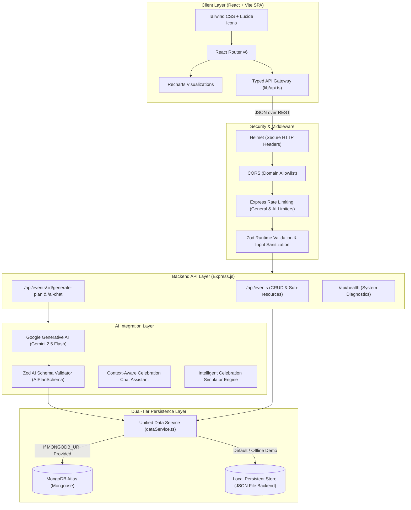

# Festivo AI: System Architecture & Technical Specifications

**Festivo AI: Your Intelligent Celebration Planner**  
*Tagline: Every Celebration, Beautifully Planned.*

---

## 1. Architectural Overview

Festivo AI is architected as a modern, decoupled full-stack celebration planning SaaS and intelligent assistant designed for high reliability, responsiveness, and seamless multi-user collaboration.

---

## 2. Component Design & Responsibilities

### 2.1 Frontend Client (`client/`)
- **Framework**: React 18 with TypeScript and Vite for near-instant hot module reloading and optimized production tree-shaking.
- **Styling**: Tailwind CSS with a custom-crafted luxury palette (warm ivory `#FDFBF7`, deep plum `#2A0D1E`, festive coral `#F25C3B`, and antique gold `#DFCA71`).
- **Data Visualization**: Recharts library for rendering responsive category bar charts (Estimated vs. Actual) and category distribution pie charts.
- **Micro-Interactions**: Canvas Confetti animations on milestone completion and plan generation.
- **Print Engine**: Dedicated `@media print` CSS delivering executive, boardroom-quality PDF / paper dossiers without extraneous UI chrome.

### 2.2 Backend Service (`server/`)
- **Runtime**: Node.js v24+ with Express.js and TypeScript.
- **API Architecture**: Clean RESTful design with typed sub-resources (`/expenses`, `/tasks`, `/vendors`, `/ideas`, `/chat-history`).
- **Validation**: Strict Zod schemas on every ingress endpoint preventing negative values, invalid dates, malformed payloads, or prototype pollution.
- **Defensive Error Handling**: Centralized Express error handler suppressing internal stack traces in client responses while logging actionable diagnostics server-side.

### 2.3 Generative AI Engine (`server/src/services/aiService.ts`)
- **Model**: Google Gemini (`gemini-2.5-flash`), configured via official `@google/generative-ai` SDK with strict JSON output mode.
- **Structured 13-Point Plan**:
  1. *Section A*: Executive Celebration Summary
  2. *Section B*: Recommended Design Themes (vibe, description, 4-color palette)
  3. *Section C*: Decoration & Staging Specs
  4. *Section D*: Venue Recommendations & Considerations
  5. *Section E*: Catering & Menu Ideas (welcome drinks, starters, mains, desserts, dietary notes)
  6. *Section F*: Entertainment & Guest Experiences
  7. *Section G*: Mathematically Exact Budget Allocations (adds up to 100% of budget)
  8. *Section H*: Chronological Preparation Timeline
  9. *Section I*: Vendor Checklist & Inquiries
  10. *Section J*: Event-Day Master Schedule (Run-of-Show)
  11. *Section K*: Risk Mitigation & Contingency Plans
  12. *Section L*: Personalized Recommendations
  13. *Section M*: High-Impact Cost-Saving Opportunities
- **Conversational Assistant**: Context-aware advisor retaining the event's current budget, actual spent, remaining envelope, and recent dialog turns to formulate concrete, actionable advice.

### 2.4 Data Persistence & Demo Mode Strategy (`server/src/services/dataService.ts`)
- **Dual Mode Operation**:
  - **Production Mode**: Automatically connects to MongoDB Atlas when `MONGODB_URI` is provided, utilizing Mongoose models.
  - **Demo Mode**: When no database URI is configured, the server operates on a file-backed local JSON store (`server/data/events.json`) with automatic seeding of realistic Indian celebrations (Royal Udaipur Wedding, Bangalore Kids Wonderland Birthday, Pune Community Diwali Gala).
- **Transparency**: An interactive status indicator in the top navigation explicitly informs the user whether MongoDB Atlas or Local Demo Mode is active.

---

## 3. Security Hardening

1. **Server-Side API Credentials**: `GEMINI_API_KEY` and `MONGODB_URI` are never bundled into the client bundle or sent over network headers.
2. **Rate Limiting**: Rate limiters protect AI generation endpoints (30 requests per 5 minutes) and API routes (300 requests per 15 minutes).
3. **Payload Sanitization**: JSON parser enforces a 1 MB body size cap to mitigate resource starvation attacks.
4. **CORS Governance**: Configured to restrict origin requests in production while permitting development inspection.
5. **No Secrets in Version Control**: `.gitignore` strictly eliminates `.env`, build artifacts, and runtime files.

---

## 4. Deployment Topography

- **Frontend**: Static SPA deployed to Vercel / Netlify / Render Static Sites.
- **Backend**: Containerized or native Node.js process deployed to Render, Railway, or Fly.io.
- **Database**: MongoDB Atlas M0 Free Tier or serverless cluster.
- **Monorepo Co-location Option**: The Express server includes static file serving logic to serve `client/dist` directly for single-container hosting on Render.
