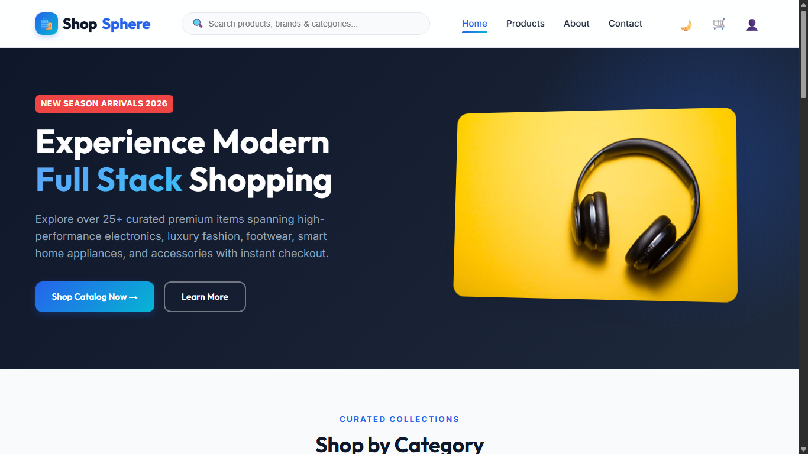
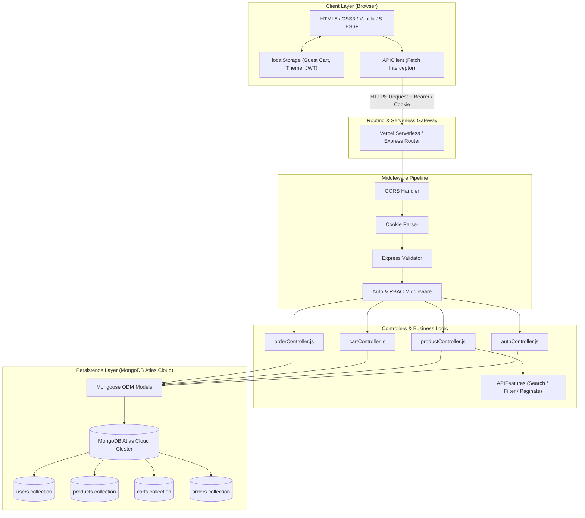
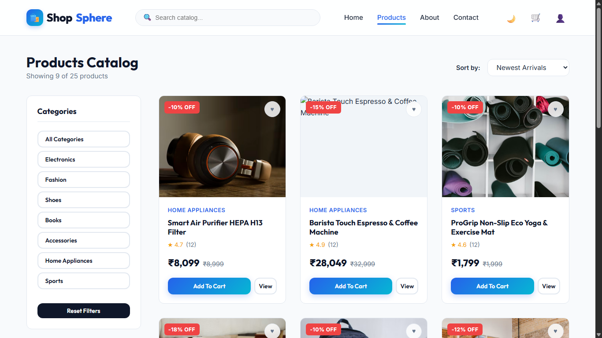
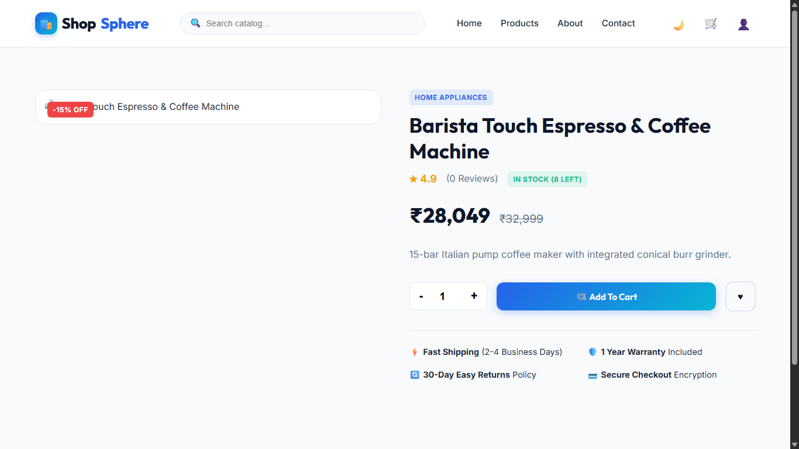
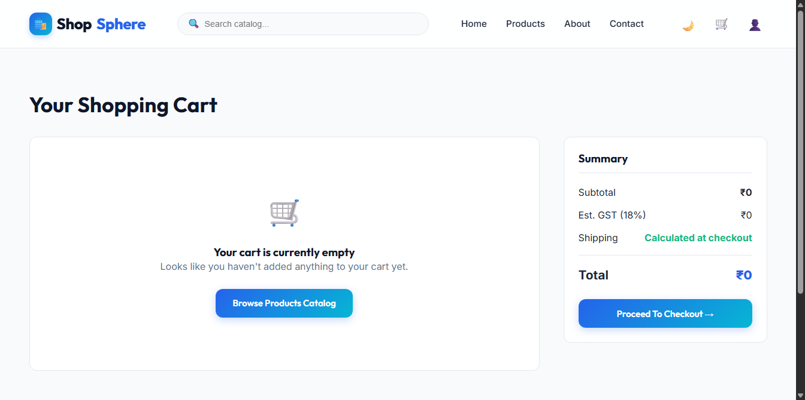
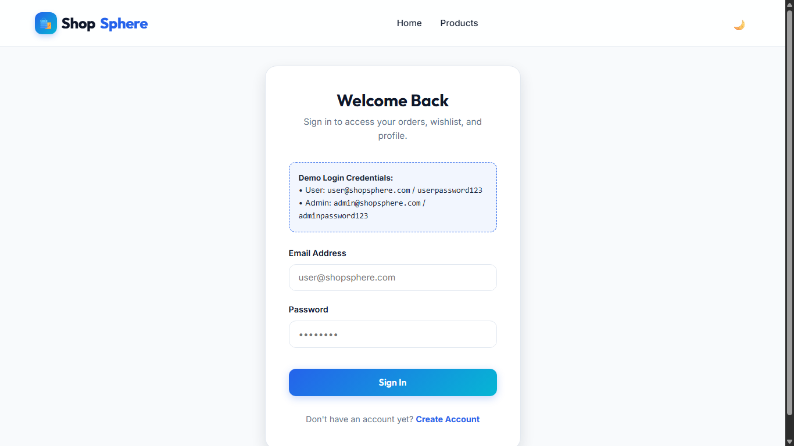
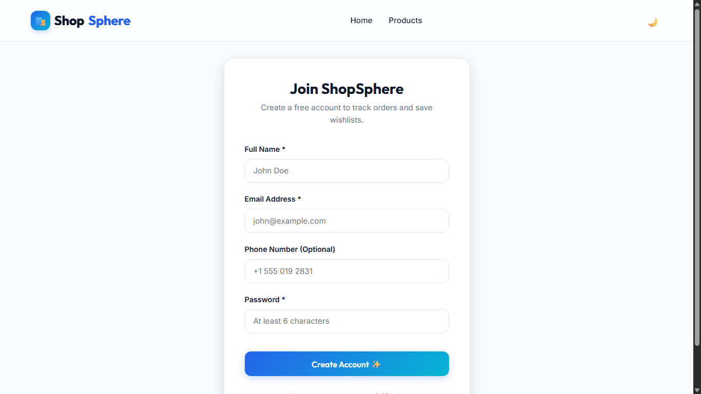

# 🛍️ ShopSphere — Full-Stack E-Commerce Platform

<div align="center">

  <!-- Project Logo / Icon Banner -->
  <p align="center">
    
  </p>

  <h3>Next-Generation, Scalable Full-Stack E-Commerce Architecture</h3>

  <p align="center">
    A robust, modern Model-View-Controller (MVC) e-commerce solution built with Node.js, Express, MongoDB Atlas, and vanilla modern JavaScript (ES6+), designed for performance, modularity, and seamless user experiences.
  </p>

  <!-- Live Links & Badges -->
  <p align="center">
    <a href="https://shopspheree-commercestore.vercel.app/" target="_blank">
      
    </a>
    <a href="https://github.com/Shree0802/ShopSphere_E-Commerce_Store" target="_blank">
      
    </a>
  </p>

  <!-- Technology Badges -->
  <p align="center">
    
    
    
    
    
    
    
    
  </p>

</div>

---

## Homepage & Hero Discovery Banner
> The landing page introduces the store's visual identity, presenting a hero promotional banner, category quick-navigation chips, and a dynamic featured product showcase powered by MongoDB Atlas.

<p align="center">
  
</p>

---

## 📑 Table of Contents

- [Overview](#-overview)
- [Problem Statement & Objectives](#-problem-statement--objectives)
- [Key Features](#-key-features)
  - [🔐 Authentication & Authorization](#-authentication--authorization)
  - [📦 Product Catalog, Search & Filtering](#-product-catalog-search--filtering)
  - [🛒 Shopping Cart & Guest Cart Synchronization](#-shopping-cart--guest-cart-synchronization)
  - [❤️ Wishlist Management](#️-wishlist-management)
  - [💳 Multi-Step Checkout & Stock Decrementing](#-multi-step-checkout--stock-decrementing)
  - [📦 Order Tracking & User Dashboard](#-order-tracking--user-dashboard)
  - [🎨 Design System & Theme Engine](#-design-system--theme-engine)
  - [🍃 Database Health & Diagnostics](#-database-health--diagnostics)
- [Technology Stack](#-technology-stack)
- [System Architecture](#-system-architecture)
- [Project Directory Structure](#-project-directory-structure)
- [Database Models & Schemas](#-database-models--schemas)
- [REST API Reference](#-rest-api-reference)
- [Local Installation & Setup Guide](#-local-installation--setup-guide)
- [Environment Configuration](#-environment-configuration)
- [Project Interface & Screenshots](#project-interface)
- [Security Architecture](#-security-architecture)
- [Production Deployment](#-production-deployment)
- [Limitations & Future Roadmap](#-limitations--future-roadmap)
- [Author & Acknowledgments](#-author--acknowledgments)
- [License](#-license)

---

## 🌟 Overview

**ShopSphere** is a production-ready, full-stack e-commerce web application engineered to deliver a seamless shopping experience. Built for the **CodeAlpha Full-Stack Development Internship**, the platform combines a robust Model-View-Controller (MVC) Node.js/Express backend with an interactive vanilla HTML5, CSS3, and JavaScript ES6+ frontend.

The project connects to a **MongoDB Atlas Cloud Database**, features JSON Web Token (JWT) role-based session authentication with HTTP-only cookie support, and includes a full suite of commercial shopping capabilities — from live product search and dynamic category filtering to multi-step checkout, guest cart persistence, and order lifecycle management.

- **Production URL:** [https://shopspheree-commercestore.vercel.app/](https://shopspheree-commercestore.vercel.app/)
- **Repository:** [https://github.com/Shree0802/ShopSphere_E-Commerce_Store](https://github.com/Shree0802/ShopSphere_E-Commerce_Store)

---

## 🎯 Problem Statement & Objectives

### Problem Statement
Modern digital shoppers face disjointed navigation, clunky cart handoffs, unoptimized search experiences, and slow page loads on monolithic frameworks. Developers learning full-stack engineering often rely on heavy opinionated frontends (e.g., React/Angular) without understanding the core principles of DOM manipulation, HTTP request-response cycles, session security, and state synchronization.

### Objectives
1. **Lightweight, High-Performance Frontend:** Build a lightning-fast, dependency-free UI using native Web APIs, modular vanilla JavaScript, CSS custom properties, and responsive CSS grid/flexbox layouts.
2. **Production-Grade RESTful API:** Structure an idiomatic Express.js server adhering to MVC principles, standard HTTP status codes, structured error handling, and declarative input validation.
3. **Cloud Database Architecture:** Integrate MongoDB Atlas with Mongoose schemas, handling automated seeding, index validation, inventory decrementing, and database health inspection.
4. **Resilient Session & State Flow:** Support guest shopper browsing with `localStorage` fallback while guaranteeing seamless guest-to-authenticated cart synchronization upon login.

---

## 🚀 Key Features

### 🔐 Authentication & Authorization
- **Dual-Token Delivery:** Issues secure JWTs accessible both via `Bearer` Authorization headers and secure `HttpOnly` cookies.
- **Salt-Hashed Passwords:** Implements `bcryptjs` with auto-salted hashing (`pre('save')` Mongoose hook).
- **Role-Based Access Control (RBAC):** Middleware checks enforce permissions (`user` vs. `admin`) across protected catalog management and checkout routes.
- **Persistent User Sessions:** Synchronizes login state across all HTML pages via `localStorage` and centralized authentication listeners.

### 📦 Product Catalog, Search & Filtering
- **25 Pre-Seeded Products:** Realistic catalog across 7 diverse categories (*Electronics, Fashion, Shoes, Books, Accessories, Home Appliances, Sports*).
- **Full-Text Keyword Search:** Case-insensitive search across product titles, descriptions, and categories (`$regex` MongoDB queries).
- **Multi-Parametric Filtering:** Filter simultaneously by category, rating threshold, and numeric price range (`$gte`, `$lte`).
- **Dynamic Sorting & Pagination:** Sort by price (low-to-high, high-to-low), newest arrivals, or customer ratings with configurable per-page limits.

### 🛒 Shopping Cart & Guest Cart Synchronization
- **Guest-First Shopping:** Unauthenticated users can freely add, modify, and delete items; cart state is maintained locally in browser storage.
- **Automated Cloud Sync:** When a guest logs in or registers, their local cart items seamlessly merge with their cloud MongoDB cart session.
- **Live Pricing Engine:** Dynamically calculates subtotal, 18% GST/tax, flat shipping fees (free shipping above ₹1,000 threshold), and final order totals.

### ❤️ Wishlist Management
- **Personalized Wishlist:** Toggle any product to/from the user's private wishlist with real-time UI indicator feedback.
- **Mongoose Reference Arrays:** Wishlist item IDs are stored as relational ObjectIds linking to the `Product` collection.

### 💳 Multi-Step Checkout & Stock Decrementing
- **Structured Address Collection:** Validates street, city, state, postal code, and country fields.
- **Multiple Payment Method Selection:** Supports Credit/Debit Card, UPI / Net Banking, and Cash on Delivery (COD).
- **Atomic Stock Decrementing:** During order creation, the server validates stock availability and decrements product inventory atomically before finalizing the transaction.

### 📦 Order Tracking & User Dashboard
- **Order Lifecycle History:** Logged-in customers can track order statuses (*Pending, Processing, Shipped, Delivered, Cancelled*).
- **Order Details Breakdown:** Complete view of ordered items, item quantities, pricing breakdown, shipping addresses, and transaction timestamps.
- **User Profile Management:** Update personal contact details, phone numbers, and saved shipping addresses.

### 🎨 Design System & Theme Engine
- **Dark & Light Mode:** Toggleable color themes with instantaneous CSS variable switching and `localStorage` persistence.
- **Custom Toast Notifications:** Non-intrusive floating toasts (`Toast.success`, `Toast.error`, `Toast.info`) provide real-time operational feedback.
- **Fully Responsive:** Optimized layouts for mobile viewports (<480px), tablets (768px), and high-resolution desktop displays.

### 🍃 Database Health & Diagnostics
- **Live Status CLI Tool:** Built-in `npm run db:status` script displays real-time connection status, collection document counts, customer accounts, and recent orders.
- **Automated Seeding:** Fallback mechanism that detects an empty catalog and populates all 25 products with INR (₹) pricing automatically.

---

## 🛠️ Technology Stack

| Layer | Technology | Purpose |
| :--- | :--- | :--- |
| **Frontend** | **HTML5** | Semantic markup across 13 dedicated application pages |
| | **CSS3** | Custom design system, CSS custom properties, grid/flexbox, animations |
| | **JavaScript (ES6+)** | Modular client-side business logic, DOM management, Fetch API wrapper |
| **Backend** | **Node.js** | Server-side JavaScript runtime environment |
| | **Express.js (v4.19)** | RESTful API routing, MVC architecture, middleware pipeline |
| **Database** | **MongoDB Atlas** | Cloud-hosted NoSQL document database cluster |
| | **Mongoose ODM (v8.4)** | Schema modeling, validation, pre-save hooks, and population queries |
| **Security & Auth**| **JSON Web Tokens (JWT)** | Stateless cryptographically signed session tokens |
| | **bcryptjs** | One-way salt hashing for user password protection |
| | **Express Validator** | Declarative request payload sanitation and schema validation |
| | **Cookie Parser** | HTTP cookie serialization and extraction for JWT storage |
| | **CORS** | Configured cross-origin resource sharing with credentials enabled |
| **Deployment** | **Vercel** | Serverless production hosting with `vercel.json` rewrite routing |

---

## 🏗️ System Architecture



---

## 📁 Project Directory Structure

```text
ShopSphere_E-Commerce_Store/
│
├── .env.example               # Template for required environment variables
├── .gitignore                  # Git ignore rules (node_modules, .env, logs)
├── package.json                # Project manifest, dependencies, and npm scripts
├── package-lock.json           # Deterministic dependency tree lockfile
├── vercel.json                 # Vercel serverless functions and URL rewrite rules
├── README.md                   # Comprehensive project documentation
│
├── api/
│   └── index.js                # Vercel Serverless Function entry point & HTTP router
│
├── client/                     # Frontend Application Assets
│   ├── index.html              # Landing page (Hero banner, featured products, categories)
│   ├── css/
│   │   ├── main.css            # Base styles, CSS custom properties, typography
│   │   ├── components.css      # Header, navbar, cards, badges, buttons, modals
│   │   ├── dark-mode.css       # Dark theme color tokens & overrides
│   │   └── responsive.css      # Breakpoints for mobile, tablet, and widescreen
│   ├── js/
│   │   ├── api.js              # Centralized Fetch wrapper with JWT interceptor
│   │   ├── auth.js             # User session, registration, login, and logout
│   │   ├── cart.js             # Shopping cart state manager & guest synchronization
│   │   ├── checkout.js         # Multi-step checkout, address validator & order submission
│   │   ├── main.js             # Global event listeners, mobile drawer, search suggestion
│   │   ├── product-details.js  # Single product view, image gallery, quantity selector
│   │   ├── products.js         # Catalog renderer, filter listeners, sorting, pagination
│   │   ├── profile.js          # User dashboard, profile update, order history display
│   │   ├── toast.js            # Non-blocking floating notification engine
│   │   └── wishlist.js         # Wishlist management and toggle handler
│   └── pages/
│       ├── 404.html            # Custom Page Not Found screen
│       ├── about.html          # Brand story, mission statement, customer guarantees
│       ├── cart.html           # Full shopping cart interface with line-item totals
│       ├── checkout.html       # Shipping address collection & payment selection
│       ├── contact.html        # Customer support inquiry form
│       ├── login.html          # Customer and administrator sign-in page
│       ├── order-history.html  # Comprehensive order history timeline
│       ├── order-success.html  # Post-purchase order confirmation & invoice overview
│       ├── product-details.html# Single product deep-dive & specification sheet
│       ├── products.html       # Full catalog exploration with sidebar filters
│       ├── profile.html        # Customer account settings & address book
│       └── register.html       # Customer registration page with input validation
│
└── server/                     # Backend Application
    ├── server.js               # Local development Express server bootstrap
    ├── config/
    │   └── db.js               # Mongoose connection with DNS fallback & auto-seeder
    ├── controllers/
    │   ├── authController.js   # User registration, login, profile, and wishlist handlers
    │   ├── cartController.js   # Cart retrieval, addition, update, and clear handlers
    │   ├── orderController.js  # Order creation, inventory decrement, order lookup
    │   └── productController.js# Product CRUD, category aggregation, featured products
    ├── middleware/
    │   ├── authMiddleware.js   # JWT verification (`protect`) & role verification (`admin`)
    │   ├── errorMiddleware.js  # 404 Not Found & centralized JSON error handler
    │   ├── uploadMiddleware.js # Multer file upload configuration
    │   └── validateMiddleware.js# Express-validator validation suites
    ├── models/
    │   ├── Cart.js             # Shopping cart schema with sub-document item array
    │   ├── Order.js            # Order schema with shipping address, totals, and statuses
    │   ├── Product.js          # Product schema with category enum, pricing, and stock
    │   └── User.js             # User schema with bcrypt hook, role, and wishlist refs
    ├── seeders/
    │   └── seedData.js         # 25 products & default admin/user account seeder
    └── utils/
        ├── apiFeatures.js      # Search, filter, sort, and pagination builder
        ├── dbStatus.js         # Command-line database inspector utility
        ├── generateToken.js    # JWT token generator with signed expiration
        └── migrateToAtlas.js   # Local-to-Atlas cloud database migration utility
```

---

## 🗄️ Database Models & Schemas

The database schema is designed around 4 primary Mongoose models with relational references:

```
┌──────────────────┐             ┌──────────────────┐
│       User       │             │     Product      │
├──────────────────┤             ├──────────────────┤
│ _id              │             │ _id              │
│ name             │             │ name             │
│ email (unique)   │             │ description      │
│ password (hash)  │             │ category (enum)  │
│ phone            │             │ price (INR)      │
│ address (nested) │             │ discount (%)     │
│ role (user/admin)│             │ stock            │
│ wishlist [ref]───┼────────────>│ rating           │
└────────┬─────────┘             │ image (URL)      │
         │ 1:1                   │ isFeatured       │
         v                       └────────┬─────────┘
┌──────────────────┐                      │
│       Cart       │                      │
├──────────────────┤                      │
│ _id              │                      │
│ user [ref]       │                      │
│ items [          │                      │
│   product [ref]──┼──────────────────────┤
│   quantity       │                      │
│   price          │                      │
│ ]                │                      │
│ totalPrice       │                      │
└──────────────────┘                      │
         │ 1:N                            │
         v                                v
┌──────────────────────────────────────────────┐
│                    Order                     │
├──────────────────────────────────────────────┤
│ _id                                          │
│ user [ref]                                   │
│ orderItems [ product [ref], name, qty, price]│
│ shippingAddress { street, city, state, zip } │
│ paymentMethod (Credit Card / UPI / COD)      │
│ itemsPrice, taxPrice, shippingPrice, total   │
│ status (Pending / Processing / Shipped / ..) │
│ isPaid, paidAt                               │
└──────────────────────────────────────────────┘
```

---

## 📡 REST API Reference

All API routes are served under the `/api` prefix and return standard JSON payloads.

### 1. Authentication & User Profile (`/api/auth`)

| Method | Endpoint | Description | Access | Auth Required |
| :--- | :--- | :--- | :--- | :--- |
| `POST` | `/api/auth/register` | Register new user account | Public | No |
| `POST` | `/api/auth/login` | Authenticate user, return token & cookie | Public | No |
| `POST` | `/api/auth/logout` | Clear authentication session & cookie | Public | No |
| `GET` | `/api/auth/profile` | Retrieve profile of authenticated user | Private | `Bearer <token>` / Cookie |
| `PUT` | `/api/auth/profile` | Update profile info, contact & addresses | Private | `Bearer <token>` / Cookie |
| `POST` | `/api/auth/wishlist/:productId` | Toggle product ID in/out of wishlist | Private | `Bearer <token>` / Cookie |

### 2. Product Catalog (`/api/products`)

| Method | Endpoint | Description | Access | Auth Required |
| :--- | :--- | :--- | :--- | :--- |
| `GET` | `/api/products` | Query products (`?search=`, `?category=`, `?sort=`, `?page=`, `?limit=`) | Public | No |
| `GET` | `/api/products/featured` | Fetch top featured products for carousel | Public | No |
| `GET` | `/api/products/categories` | Retrieve list of categories with product counts | Public | No |
| `GET` | `/api/products/:id` | Fetch detailed product information by ID | Public | No |
| `POST` | `/api/products` | Create new catalog product | Admin | `Bearer <token>` (Admin Role) |
| `PUT` | `/api/products/:id` | Update product details, stock, or price | Admin | `Bearer <token>` (Admin Role) |
| `DELETE` | `/api/products/:id` | Permanently remove product from catalog | Admin | `Bearer <token>` (Admin Role) |

### 3. Shopping Cart (`/api/cart`)

| Method | Endpoint | Description | Access | Auth Required |
| :--- | :--- | :--- | :--- | :--- |
| `GET` | `/api/cart` | Retrieve user's current shopping cart | Private | `Bearer <token>` / Cookie |
| `POST` | `/api/cart` | Add product to cart or increment quantity | Private | `Bearer <token>` / Cookie |
| `PUT` | `/api/cart/item` | Update exact quantity of a cart line item | Private | `Bearer <token>` / Cookie |
| `DELETE` | `/api/cart/item/:productId` | Remove a specific product from cart | Private | `Bearer <token>` / Cookie |
| `DELETE` | `/api/cart` | Empty all items from user's cart | Private | `Bearer <token>` / Cookie |

### 4. Orders & Checkout (`/api/orders`)

| Method | Endpoint | Description | Access | Auth Required |
| :--- | :--- | :--- | :--- | :--- |
| `POST` | `/api/orders` | Place new order, decrement inventory, clear cart | Private | `Bearer <token>` / Cookie |
| `GET` | `/api/orders` | Retrieve authenticated user's order history | Private | `Bearer <token>` / Cookie |
| `GET` | `/api/orders/:id` | Retrieve specific order details by ID | Private | `Bearer <token>` / Cookie |
| `PUT` | `/api/orders/:id/pay` | Mark order status as paid with timestamp | Private | `Bearer <token>` / Cookie |

### 5. System Health (`/api/health`)

| Method | Endpoint | Description | Access | Auth Required |
| :--- | :--- | :--- | :--- | :--- |
| `GET` | `/api/health` | Returns server operational status & timestamp | Public | No |

---

## 💻 Local Installation & Setup Guide

Follow these steps to run the complete ShopSphere application locally on your computer.

### Prerequisites
- **Node.js**: v18.0.0 or higher ([Download Node.js](https://nodejs.org/))
- **npm**: v9.0.0 or higher (packaged with Node.js)
- **MongoDB**: A free [MongoDB Atlas](https://www.mongodb.com/cloud/atlas) cluster URI **OR** a local [MongoDB Community Server](https://www.mongodb.com/try/download/community) instance running on port 27017.

---

### Step 1: Clone the Repository

```bash
git clone https://github.com/Shree0802/ShopSphere_E-Commerce_Store.git
cd ShopSphere_E-Commerce_Store
```

### Step 2: Install Dependencies

```bash
npm install
```

### Step 3: Configure Environment Variables

Create a `.env` file in the root directory by copying the provided example:

```bash
# On Windows PowerShell
Copy-Item .env.example .env

# On macOS / Linux
cp .env.example .env
```

Open `.env` and configure your settings:

```env
PORT=5000
NODE_ENV=development
MONGODB_URI=mongodb+srv://<username>:<password>@your-cluster.mongodb.net/shopsphere?retryWrites=true&w=majority
JWT_SECRET=your_super_secret_jwt_random_key_here
JWT_EXPIRE=30d
COOKIE_EXPIRE=30
```

> **Note:** If using local MongoDB, set `MONGODB_URI=mongodb://localhost:27017/shopsphere`.

### Step 4: Seed the Database

Populate your database with 25 realistic products across all 7 categories, plus test accounts:

```bash
npm run seed
```

**Seeded Credentials for Local Testing:**
- **Administrator:** `admin@shopsphere.com` / `adminpassword123`
- **Standard Customer:** `user@shopsphere.com` / `userpassword123`

### Step 5: Verify Database Connection & Records

Run the built-in diagnostic tool to inspect your active database:

```bash
npm run db:status
```

### Step 6: Start the Server

```bash
# For development with nodemon hot-reload
npm run dev

# For standard production mode
npm start
```

Open your browser and navigate to:
```text
http://localhost:5000
```

---

## ⚙️ Environment Configuration

| Variable Name | Required | Default Value | Description |
| :--- | :---: | :--- | :--- |
| `PORT` | No | `5000` | Port on which the local Express server listens |
| `NODE_ENV` | Yes | `development` | Environment mode (`development` or `production`) |
| `MONGODB_URI` | Yes | *None (Required)* | MongoDB connection string (Local or MongoDB Atlas) |
| `JWT_SECRET` | Yes | *None (Required)* | High-entropy secret key for signing JSON Web Tokens |
| `JWT_EXPIRE` | No | `30d` | Token validity lifespan (e.g., `7d`, `30d`) |
| `COOKIE_EXPIRE` | No | `30` | Browser cookie expiration in days |

> 🔒 **Security Notice:** Never commit your actual `.env` file or cloud database credentials to version control. The repository `.gitignore` automatically excludes `.env`.

---

<a id="project-interface"></a>
## 🖥️ Project Interface

A visual walkthrough of the actual running **ShopSphere** web application, showcasing the responsive UI/UX, catalog discovery, interactive cart, and checkout workflows.

---

### 1. Homepage & Hero Discovery Banner
> The landing page introduces the store's visual identity, presenting a hero promotional banner, category quick-navigation chips, and a dynamic featured product showcase powered by MongoDB Atlas.

<p align="center">
  
</p>

---

### 2. Products Listing & Multi-Parametric Filter
> Comprehensive catalog exploration view with live keyword search, category taxonomy sidebar, dynamic price range slider, and pagination controls.

<p align="center">
  
</p>

---

### 3. Product Details Page
> Deep-dive view of individual catalog products displaying high-resolution imagery, pricing in Indian Rupees (₹), discount badges, rating stars, live stock counters, and Add to Cart controls.

<p align="center">
  
</p>

---

### 4. Interactive Shopping Cart
> Real-time shopping cart management displaying line items, quantity adjustment controls, line totals, 18% GST tax calculation, and free delivery thresholds. Supports unauthenticated guest storage and cloud synchronization upon login.

<p align="center">
  
</p>

---

### 5. Authentication & Registration Pages
> Secure customer onboarding and sign-in interfaces utilizing JSON Web Tokens (JWT) and bcrypt password hashing with real-time field validation and toast notifications.

| User Login Interface | Customer Registration Interface |
| :---: | :---: |
|  |  |
| *Email & password authentication with JWT token issuance* | *Account creation form with input sanitization and password rules* |

---

## 🛡️ Security Architecture

ShopSphere implements practical defense-in-depth security patterns:

- **Salted Password Hashing:** Passwords are never saved in plaintext. Using `bcryptjs`, passwords are automatically hashed with 10 salt rounds before persistence.
- **Stateless Cryptographic Sessions:** Authentication relies on signed JSON Web Tokens (JWT) using HMAC-SHA256, verified on every protected request.
- **Dual-Token Interception:** The client API interceptor automatically reads tokens from both `Authorization: Bearer <token>` and `HttpOnly` cookie stores.
- **Role-Based Gateways:** Sensitive operations (such as product creation or administrative management) are guarded by sequential middleware checks (`protect` then `admin`).
- **Declarative Request Validation:** Express-validator checks all incoming registration, login, product, and order payloads before touching controllers, rejecting malformed inputs.
- **Inventory Concurrency Guard:** The order processor checks available stock before committing an order, rejecting transactions if requested quantities exceed inventory.

---

## 🚀 Production Deployment

ShopSphere is pre-configured for zero-friction serverless deployment on **Vercel** with a **MongoDB Atlas Cloud Database**.

### Deploying on Vercel:

1. **Push your repository** to your GitHub account:
   ```bash
   git push -u origin main
   ```
2. Log in to [Vercel](https://vercel.com/) and click **"Add New..."** → **"Project"**.
3. Import your **`ShopSphere_E-Commerce_Store`** repository.
4. Keep the default settings:
   - **Framework Preset:** `Other`
   - **Root Directory:** `./`
5. Expand the **Environment Variables** panel and add:
   - `MONGODB_URI` = `mongodb+srv://<username>:<password>@your-cluster.mongodb.net/shopsphere?retryWrites=true&w=majority`
   - `JWT_SECRET` = `your_strong_jwt_production_secret`
   - `NODE_ENV` = `production`
6. Click **Deploy**.

> 🌐 **MongoDB Atlas Network Access Tip:** Ensure you have added `0.0.0.0/0` (Allow Access from Anywhere) under **Network Access** in MongoDB Atlas so Vercel's serverless edge instances can connect without IP restrictions.

---

## 🧭 Limitations & Future Roadmap

### Current Boundaries
- **Simulated Payment Processing:** Checkout verifies address and updates order status with simulated payment confirmation. It does not currently integrate a third-party gateway (e.g., Stripe, Razorpay) webhook.
- **Client-Side Templating:** Frontend relies on vanilla multi-page HTML documents with dynamic client fetch rendering rather than server-side rendering (SSR).

### Future Roadmap
- [ ] Integrate **Razorpay / Stripe** payment gateway with signed webhook verifications.
- [ ] Add **OAuth 2.0 Social Sign-In** (Google & GitHub authentication).
- [ ] Implement **Automated Email Notifications** via Nodemailer / SendGrid for order receipts and shipping updates.
- [ ] Build an **Enhanced Admin Analytics Dashboard** with sales charts and revenue metrics.
- [ ] Add automated unit and integration tests using **Jest** and **Supertest**.

---

## 👤 Author & Acknowledgments

- **Developer:** Shree (Prathamesh Patil)
- **GitHub:** [@Shree0802](https://github.com/Shree0802)
- **Project:** Created as part of the **CodeAlpha Full-Stack Development Internship**

Special thanks to the open-source community for the tools, libraries, and resources that made this project possible.

---

## 📄 License

This project is licensed under the **ISC License** — see the [package.json](package.json) file for details.

```text
Copyright (c) 2026 CodeAlpha Intern / Shree0802

Permission to use, copy, modify, and/or distribute this software for any
purpose with or without fee is hereby granted, provided that the above
copyright notice and this permission notice appear in all copies.
```

---

<div align="center">
  <sub>Designed & Developed ❤️ by Prathamesh B. Patil.</sub>
</div>
